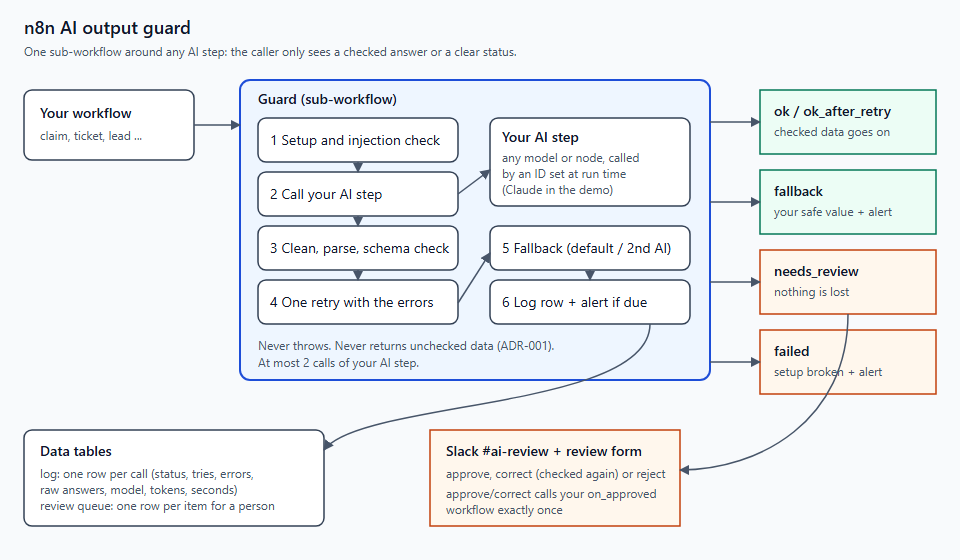

# n8n AI Output Guard

## Problem
An AI step inside an automation sometimes returns broken or wrong output: malformed JSON, missing fields, a refusal, or an API timeout. The next step then crashes or saves bad data, and often nobody notices until a customer does.

## Solution
To be written when the build lands.

## System

## Outcome
To be written from the recorded test runs only.

## Version Log
| version | date | change |
|---|---|---|
| 0.0 | 2026-10-18 | Scaffold |
