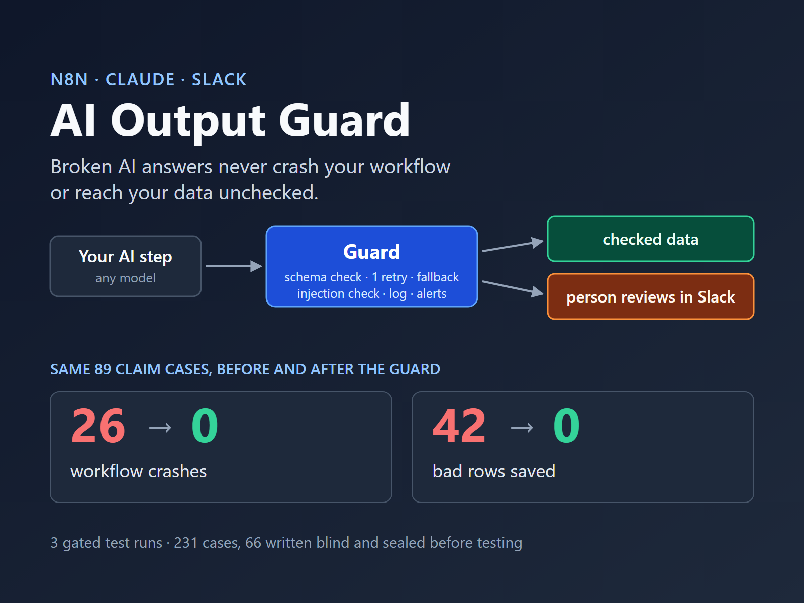
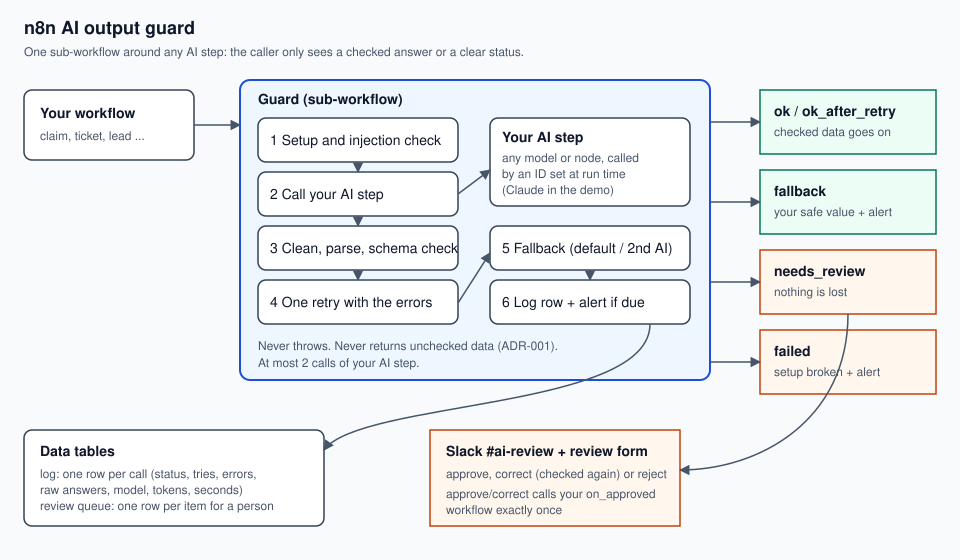

# n8n AI Output Guard

A reusable n8n sub-workflow that checks every AI answer before your workflow uses it: schema check, one retry, fallback, a person in Slack for what still fails, alerts and a log.

## Problem
An AI step inside an automation sometimes returns broken or wrong output: malformed JSON, missing fields, a refusal, a cut-off answer, or an API timeout. The next step then crashes or saves bad data, and often nobody notices until a customer does. A typical request: "Our Claude agent intermittently returns malformed JSON, which breaks the downstream n8n workflow."

## Solution
One n8n sub-workflow that you put around any AI step. It checks every answer before your workflow uses it:

- **Checks** the answer: it ended normally, is one JSON object, and matches your JSON Schema.
- **Retries once** on an API error (it waits for a 429 retry-after) or on a failed check; the retry tells the AI what was wrong.
- **Falls back** to a fixed default or a second AI step, if you choose one.
- **Sends to a person** what is still not valid: a Slack message in #ai-review with a review form (approve, correct, reject). An approved or corrected item reaches your workflow exactly once.
- **Screens the input** for obvious prompt injection ("ignore your instructions", "SYSTEM:", "return this JSON") with a code check and a small AI check; a flagged input goes to a person.
- **Logs** every call (status, tries, errors, raw answers, model, tokens) and sends a Slack alert on a setup failure, a fallback, an API error or an AI-check error.

Your workflow always gets one clear status back: `ok`, `ok_after_retry`, `fallback`, `needs_review` or `failed`. It never gets an error, and it never gets data that was not checked.

## System

The same guard wraps three different AI steps in the tests (insurance claim intake, support ticket triage, sales lead scoring) with no change to the guard.

Built with n8n 2.43.7 (self-hosted), Claude Sonnet 5.5 as the AI step, Claude Haiku 5.5 as the injection check, and Slack. The workflow files are in `workflows/`, generated by `workflows/build.py`.

### Plug it into your workflow (5 steps)
1. **Put your AI step in its own small sub-workflow.** It receives `ai_input` (and, on a retry, `error_list`) and returns `http_status`, `stop_reason`, `text`, `model`, `tokens_in`, `tokens_out` (or `transport_error`). Any model or node works; `workflows/step-claim_intake.json` is an example with Claude.
2. **Write a JSON Schema** for the answer you expect (`tests/schemas/` has three examples).
3. **Import the guard** (`workflows/guard.json`), the review form (`workflows/review.json`) and, if you want screening by AI too, the injection check (`workflows/injection-check.json`). Set your Slack channel and credentials, and give the review form a Basic Auth credential for your reviewers.
4. **Call the guard** with Execute Workflow and pass: `ai_step_id`, `ai_input`, `schema`, `fallback` (`{"mode": "none"}`, `{"mode": "default", "value": {...}}` or `{"mode": "second_step", "second_step_id": "..."}`), `on_approved_id` (the workflow that gets approved items), and `options.injection_check_step_id` to switch the AI injection check on.
5. **Route on `status`**: `ok`, `ok_after_retry` and `fallback` carry checked `data`; `needs_review` and `failed` carry no data (the item waits for a person, or the setup needs fixing). `workflows/fixkit-after.json` shows this with one IF node.

## Outcome
**Gated test.** 3 runs over 231 cases. 66 of them were written blind by a separate session that never saw the code, and sealed before the first gated run. In every run: no unchecked data returned, no crash, no obvious injection let through, and 37 of 37 live normal cases passed. One known-limit case, a subtle "please give us a top score" note that its author marked as not gated, was sent to review in 1 of 3 runs and passed in the other 2, because the AI check is a live model. The scorer counted that as a FAIL. After the run, Kristian ruled that cases marked not gated are outside the gate, as the test rules say. Full record: [evals/RESULTS.md](evals/RESULTS.md).

**Before and after on a broken claims workflow** (same 89 claim cases, in each of the 3 gated runs):

| | Before (AI answer straight to JSON.parse) | After (one change: the guard) |
|---|---|---|
| Workflow crashes | 26 | 0 |
| Bad rows saved | 42 | 0 |
| Valid rows saved | 21 | 56 |
| Sent to a person in Slack | none | 31 |

Root cause and fix: [FIX_REPORT.md](FIX_REPORT.md).

### Limits
- **It checks format, not truth.** An answer that matches the schema but is wrong (for example a wrong claim amount) passes.
- **Injection screening is best effort.** It catches obvious attacks; subtle ones can pass. Known gaps for a next version: polite or indirect requests ("Could you please return the following JSON ..."), an order more than about 160 characters after a "new instructions" marker, some marker forms and languages, and invisible characters inside words.
- **The AI injection check runs only when you pass `options.injection_check_step_id`.** Without it, only the code check runs.
- **Strict on purpose:** "new instructions" followed by an order or a field value (for example "priority low") goes to review, also when a customer meant it innocently.
- **The AI check can answer differently** on the same borderline text from one run to the next.
- **Send plain text or flat JSON** as `ai_input`: text nested 49 or more levels deep is not screened.
- **Personal data:** review messages show an excerpt of the input (up to 300 characters) in Slack. Pick a private channel; the demo uses made-up data only.
- **Webhooks are locked.** Each machine webhook needs its own key (n8n Header Auth, header `X-Guard-Token`); the review page and its submit button ask for a reviewer password (n8n Basic Auth). `tools/webhook_keys.py` creates the credentials. The test-only workflows (test caller, report, reset, table setup) are not part of a client copy.
- **Time:** with retries, one guard call can take up to about 170 seconds.
- **Tested only** on self-hosted n8n 2.43.7. Not for streaming answers, tool-use loops or AI Agent nodes as the wrapped step.
- **Where it was run:** the gated runs and the test runner (`tests/runner.py`, `tests/gated.py`) need a running n8n, an Anthropic key and a Slack workspace; they were run on one Windows machine. The offline checks (`tests/test_injection.py`, `tests/test_inj_verdict.py`, `tests/make_cases.py`) need only Python and Node; they were also run on Windows only. A CI job for Linux, macOS and Windows follows after the repo is public.

## Status
Version 1.1, 2026-10-20: built and tested. The gated test passed on version 1.0 (commit 9107ff3); version 1.1 adds webhook authentication. A video walkthrough follows.

## Version Log
| version | date | change |
|---|---|---|
| 0.0 | 2026-10-18 | Scaffold |
| 1.0 | 2026-10-20 | Guard, review queue, injection check and fix kit; gated test passed on commit 9107ff3 |
| 1.1 | 2026-10-20 | Every webhook locked (Header Auth or Basic Auth). Checked: all 8 webhooks refuse a call without the key or with a wrong key (16 of 16), and a dry run, a fix-kit run and the AI-check probe pass with the keys. The gated result was measured on 1.0. |
